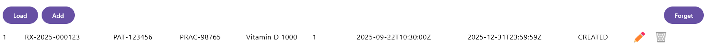
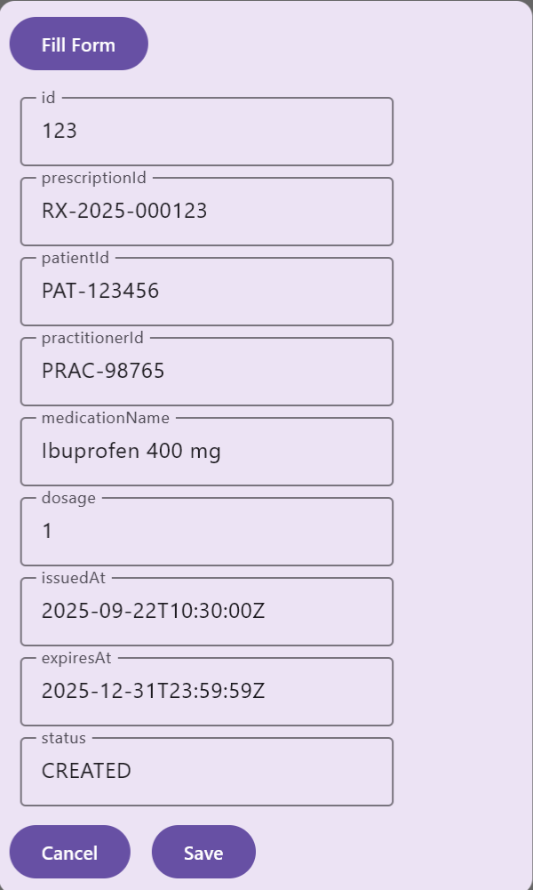

# Wie Sie den ZETA-Demo-Client bauen und ausführen

Diese Anleitung unterstützt Tester dabei, den ZETA-Demo-Client zu bauen und
auszuführen. Der Demo-Client nutzt die API des Test-Fachdienstes und bietet eine
Benutzerschnittstelle dafür.

Basierend auf dem Demo-Client kann ein eigener Testclient für andere Fachdienste
entwickelt werden. Siehe dazu auch die
[Struktur des SDK-Repositorys](../Referenzen/SDK-Uebersicht.md).

---

Status: Entwurf

Zielgruppe: Tester und Entwickler

Stand: ZETA-SDK 2.0.0

---

## Inhaltsverzeichnis

- [Überblick](#überblick)
- [Voraussetzungen](#voraussetzungen)
- [Vorgehen](#vorgehen)
  - [Abhängigkeiten / Erforderliche Konfiguration](#abhängigkeiten--erforderliche-konfiguration)
  - [Kurzanleitung](#kurzanleitung)
  - [Anleitung in Schritten](#anleitung-in-schritten)
- [Mobile Demo-Apps (Vorschau)](#mobile-demo-apps-vorschau)
- [Bedienung](#bedienung)

## Überblick

Dieses Dokument zeigt, wie Sie das SDK und den Client mit dem Build-Werkzeug
Gradle bauen.

Der Demo-Client (`zeta-client`) ist ein Kotlin-Multiplatform-Client. Er läuft
als Desktop-Anwendung in der JVM sowie als Vorschau auf Android und iOS (das
iOS-Projekt liegt in `iosApp`).

## Voraussetzungen

* Ein PC mit Windows, Linux oder Mac
* Installiertes Java Development Kit (JDK)
* Git-Client zum Herunterladen des SDK-Repositorys oder der heruntergeladene
  Inhalt des Repositorys
* Installiertes Android Software Development Kit (SDK) mit gesetzter
  `ANDROID_HOME`-Umgebungsvariable (optional)
* Für die iOS-Demo-App: ein Mac mit Xcode (optional)

Hinweis: Das SDK und der Test-Client können grundsätzlich ohne Android-SDK
gebaut werden. Im Hinblick auf die spätere Verwendung in mobilen Anwendungen
wird hier aber schon der Build für Android (und iOS auf Macs) berücksichtigt.
Welche Plattformen gebaut werden, lässt sich in der `gradle.properties` über
die Schalter `de.gematik.zeta.sdk.build-logic.enableAndroid`,
`…enableIOS`, `…enableJvm`, `…enableMacOS`, `…enableLinux` und
`…enableWindows` steuern; der Pfad zum Android SDK kann in der
`local.properties` gesetzt werden (`sdk.dir=…`).

## Vorgehen

### Abhängigkeiten / Erforderliche Konfiguration

Der Testclient braucht im Wesentlichen die Adresse des Fachdienstes und die
Angaben für die Anmeldung: entweder ein SM-B-Zertifikat als Datei oder – für
den mobilen Client-Flow – die Angaben zum sektoralen IDP.

Diese werden durch eine Konfigurationsdatei bzw. Umgebungsvariablen bereitgestellt.

Hier sind die Konfigurationswerte:

| Wert                      | Beschreibung                                                                                                         | Beispiel                                                   |
|---------------------------|----------------------------------------------------------------------------------------------------------------------|------------------------------------------------------------|
| ENVIRONMENTS              | URL(s) of the resource server as reachable via the PEP; mehrere URLs durch Leerzeichen getrennt                      | https://fachdienst.host.example.com/pep/fachdienst_url/api |
| SMB_KEYSTORE_FILE         | Path to the SM-B Certificate-File (in .p12 format)                                                                   | /smcb-certificates.p12                                     |
| SMB_KEYSTORE_ALIAS        | Alias of the key in the SM-B Certificate file                                                                        |                                                            |
| SMB_KEYSTORE_PASSWORD     | Password for the private key                                                                                         |                                                            |
| STORAGE_AES_KEY           | Base64-kodierter AES-256-Schlüssel (dekodiert genau 32 Byte), mit dem die Daten des SDK verschlüsselt gespeichert werden; unter Android unbeachtet, unter iOS hält der Standard-Speicher die Daten nur im Arbeitsspeicher | Ausgabe von `openssl rand -base64 32`                      |
| REQUIRED_ROLE_OID         | Role-OID, die das TI-Zertifikat des ASL-Servers enthalten muss; wird beim ASL-Handshake geprüft                      | 1.2.276.0.76.4.156                                         |
| ASL_PROD                  | Produktiv- (`true`, Default) oder Nicht-Produktivmodus; bei `false` werden die ASL-Schlüssel zu Testzwecken mitgegeben | true                                                       |
| POPP_TOKEN                | Wert eines PoPP-Tokens, welches an den PEP mitgegeben wird (optional)                                                | eyJhbGciOiJFUzI1NiI......                                  |
| DISABLE_SERVER_VALIDATION | Falls auf `true` gesetzt, wird die TLS-Zertifikatsprüfung des Servers ausgesetzt (für Tests)                         |                                                            |
| AUTH_MODE                 | Anmeldeverfahren: `SMB` (SM-B-Datei) oder `OIDC` (mobiler Client-Flow über den sektoralen IDP); Default ist `OIDC` auf Android und iOS, sonst `SMB` | SMB                                                        |
| OIDC_IDP_ISS              | Issuer des sektoralen IDP für den mobilen Client-Flow                                                                | https://fachdienst.host.example.com/sekidp                 |
| OIDC_IDP_ALIAS            | Alias des IDP im Keycloak-Broker des ZETA-Guards                                                                     | zeta-sekidp-oidc                                           |
| OIDC_BASE_URI             | Nur JVM und macOS: Basis-URI der lokalen Callbacks; daraus ergeben sich die Redirect-URIs `{OIDC_BASE_URI}/app` und `{OIDC_BASE_URI}/oidc`. Android und iOS nutzen fest `de.gematik.zeta://app` und `de.gematik.zeta://oidc` | http://localhost:8090/cb/demo                              |

Für `AUTH_MODE=SMB` sind die `SMB_*`-Variablen nötig, für `AUTH_MODE=OIDC` die
`OIDC_*`-Variablen. Die `SMB_*`-Variablen definieren, wo die
SM-B-Zertifikatsdatei liegt, mit der sich der Client gegenüber dem ZETA-Guard
authentifiziert. Eine Konnektor-Anbindung für SMC-B bringt der Demo-Client
nicht mit; die früheren `SMCB_*`-Variablen sind mit Version 1.2.2 entfallen.

Die Parameter-Datei sieht dabei – für ein Testszenario(!) – beispielsweise wie
folgt aus:

````
ENVIRONMENTS=<resource_server_1_api_endpoint> <resource_server_2_api_endpoint> ...

SMB_KEYSTORE_FILE=<sm-b-keystore-file>.p12
SMB_KEYSTORE_ALIAS=<key-alias-im-keystore-file>
SMB_KEYSTORE_PASSWORD=<keystore-password>

STORAGE_AES_KEY=<base64-kodierter-aes-256-schlüssel>
REQUIRED_ROLE_OID=<role-oid>
ASL_PROD=false

DISABLE_SERVER_VALIDATION=true
POPP_TOKEN=eyJhbGciOiJFUzI1N......
````

Hinweis: Die Fachdienst-URLs werden hier „ENVIRONMENTS“ genannt, da mehrere
durch Leerzeichen getrennte URLs möglich sind. Die verschiedenen URLs können im
Client ausgewählt werden. Der C++- und der C#-Client sowie der Testdriver lesen
die Fachdienst-URL dagegen aus `FACHDIENST_URL`; der Java-Client nutzt die erste
URL aus `ENVIRONMENTS` bzw. ersatzweise `FACHDIENST_URL`.

### Kurzanleitung

Nach der Konfiguration kann der Client mit dieser Kommandozeile gebaut sowie ausgeführt werden:

````
./gradlew :zeta-client:jvmRun -DmainClass="de.gematik.zeta.client.ZetaClientAppKt" --args='--ZETA_ENV_FILE=<Name-der-Parameter-Datei>'
````

### Anleitung in Schritten

#### Bauen des SDK und Deployment in ein lokales Maven-Repository

Dieser Schritt benötigt _kein_ Android SDK.

````
./gradlew publishJvmPublicationToMavenLocal
./gradlew publishKotlinMultiplatformToMavenLocal
````

#### Remote-Maven-Repository

Hinweis: Sollten Sie das ZETA-SDK in ein eigenes Remote-Repository übertragen
wollen, so müssen Sie die folgende Konfiguration in der build-logic anpassen:

| Verzeichnis                                                            | Datei               | Funktion/Variable                               | Beschreibung                                                                                                                                                         | Beispiel                                                     |
|------------------------------------------------------------------------|---------------------|-------------------------------------------------|----------------------------------------------------------------------------------------------------------------------------------------------------------------------|--------------------------------------------------------------|
| build-logic/build-logic/src/main/kotlin/de/gematik/zeta/sdk/buildlogic | BuildLogicPlugin.kt | `addGitlabRepository`<br/>URL des Maven Repositories | URL des remote Maven Repositories. Sie wird aus den Umgebungsvariablen `CI_API_V4_URL` und `CI_PROJECT_ID` der GitLab-Pipeline gebildet; das Deploy-Token stammt aus der Gradle-Property `gitLabDeployToken` bzw. der Umgebungsvariablen `DEPLOY_TOKEN` | "https://<repository-host>/api/v4/projects/3/packages/maven" |

#### Vollständige Setups

Die vollständigen Tests und Setups benötigen ein installiertes Android SDK:

##### Vollständiger Build

````
./gradlew build
````

##### Ausführen der Tests

````
./gradlew testAll
````

## Mobile Demo-Apps (Vorschau)

Die mobilen Demo-Apps melden sich standardmäßig über den mobilen Client-Flow
(OIDC) an und attestieren sich auf echten Geräten hardwarebasiert. Sie lesen
ihre Konfiguration aus einer Datei `zeta.env`, die aus der jeweiligen Vorlage
(`zeta.env.template`) erzeugt wird. Die Datei enthält lokale Geheimnisse und
wird nicht eingecheckt.

**Android**

* Konfigurationsdatei: `zeta-client/src/androidMain/assets/zeta.env` mit den oben
  beschriebenen Werten. Zusätzlich:
  * `PLAY_INTEGRITY_CLOUD_PROJECT_NUMBER` – Google-Cloud-Projektnummer für Play
    Integrity (optional; ohne sie nutzt die App nur die Key Attestation),
  * `PUSH_GATEWAY_URL` – Basis-URL des Push Gateways für die Push-Registrierung.
* Push-Benachrichtigungen über Firebase Cloud Messaging sind optional und
  standardmäßig deaktiviert. Sie werden durch eine Zeile
  `ZETA_GOOGLE_SERVICES_JSON=/pfad/zu/google-services.json` in der `zeta.env`
  eingeschaltet. Dafür ist ein Firebase-Projekt mit einer Android-App für die
  Application-ID `de.gematik.zeta.client` nötig; die `google-services.json`
  gehört außerhalb des Repositorys. Fehlt die Zeile oder zeigt sie auf eine
  nicht vorhandene Datei, bleibt die Funktion deaktiviert.
* Die Demo-App erlaubt Klartext-Verkehr für alle Domains, damit die Sperrprüfung
  OCSP-Responder und CRL-Verteilpunkte über `http://` erreicht. Eigene Apps
  sollten dies auf die betroffenen Hosts beschränken.

**iOS**

* Konfigurationsdatei: `iosApp/iosApp/iosApp/zeta.env`, erzeugt aus
  `zeta.env.template`. Für die Anmeldung über OIDC sind zusätzlich
  `OIDC_IDP_ISS` und `OIDC_IDP_ALIAS` einzutragen, die die Vorlage nicht
  enthält; die Redirect-URIs sind in der App fest vorgegeben. `APP_BUNDLE_IDS` gibt die Bundle-IDs für die
  `platformProductId` an.
* Für Push-Benachrichtigungen ist `PUSH_GATEWAY_URL` zu setzen (genau eine der
  im Notification Service erlaubten Push-Gateway-URLs). Mit echtem APNs werden
  in Xcode das Apple-Team und die Capability Push Notifications gesetzt; ohne
  bezahltes Apple-Team simuliert `APNS_MOCK=true` den Device-Token (nur im
  Simulator).
* App Attest ist nur auf echten Geräten verfügbar; im Simulator registriert sich
  die App mit Software-Attestierung.

Wie die Push-Nachrichten in den Demo-Apps verarbeitet werden, beschreibt
[Wie Sie das SDK-Notifications-Modul verwenden](Wie_Sie_das_SDK_Notifications-Modul_verwenden.md#push-empfang-in-der-app).

## Bedienung

Dieser Abschnitt zeigt, wie Sie den Demo-Client bedienen. Die Bedienung ist
weitgehend selbsterklärend; einige Besonderheiten sind aber zu beachten.

Beim Start öffnet sich ein Fenster mit der aktuellen Liste von Rezepten. Sie ist
zunächst leer, etwa wenn auch der Test-Fachdienst neu gestartet wurde.

Hier ein Bild mit einem Rezept in der Liste:



Hinweis: Das ist selbstverständlich kein echter E-Rezept-Fachdienst, sondern nur
eine Anmutung dessen, um dem Testfachdienst eine fachliche Bedeutung zu geben
und damit die CRUD-Operationen testen bzw. vorstellen zu können.

Mit dem Klick auf den „Add“-Button bzw. den „Bleistift“ in der Rezept-Zeile
kann ein neuer Eintrag erstellt bzw. geändert werden.



Bei der Erstellung eines neuen Eintrags kann mit dem „Fill Form“-Button
das Formular mit Testdaten gefüllt werden.

Hinweis: Vor dem Speichern muss allerdings das Feld `id` geleert werden.
Außerdem muss die `prescriptionId` in der Datenbank eindeutig sein.

Bei der Änderung können nur `medicationName`, `dosage`, `expiresAt` und `status`
geändert werden. Alle anderen Werte werden nicht geändert bzw. automatisch
gesetzt.

Über das Menü lassen sich außerdem die TLS-Validierung ein- und ausschalten
und CA-Dateien hochladen. Buttons erlauben es, die SDK-Funktionen einzeln
aufzurufen: „Discover“, „Register“, „Authenticate“, „Status“, „Logout“,
„Clear Registration“, „Forget“ und „Change Email“. Bei aktivierten
Push-Benachrichtigungen registriert „Test Push“ einen Pusher, „Subscribe All“
bzw. „Unsubscribe All“ schalten alle Kanäle ein bzw. aus, und „Load History“
lädt die Benachrichtigungs-Historie.
