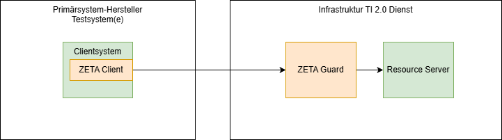

# Informationen für Primärsystem-Hersteller

Primärsystem-Hersteller binden das ZETA-SDK in ihre Primärsystemanwendungen
ein, um Dienste der TI 2.0 aufzurufen. Dieses Dokument beschreibt den Stand des
ZETA-SDK 2.0.0.

Hinweis: Die Nutzung eines mobilen Clients ist aktuell nur als Vorschau
vorhanden – siehe dazu auch das entsprechende
[ReadMe](ReadMeMobileClientHersteller.md).

## Betrachtete Nutzungsszenarien

Die ZETA-Komponenten bilden einen weitgehend transparenten Tunnel zwischen
Client und Fachdienst. Für Tests wird daher vorausgesetzt, dass
Primärsystemhersteller mindestens über einen Fachdienst-Simulator – ohne
ZETA-Guard – verfügen. Alternativ dienen eigene oder bestehende
3rd-Party-Test-Fachdienste mit vorhandenem ZETA-Guard; eine weitere Möglichkeit
ist der [gematik Test-Hub](https://github.com/gematik/ti2.0-testhub).

Dieses Dokument betrachtet daher:

1. Integration des ZETA-SDK in ein existierendes Primärsystem
2. Optionaler Aufbau eines ZETA-Guard vor einem Test-Fachdienst

Der Aufbau eines ZETA-Guard vor einem bestehenden Test-Fachdienst entspricht dem
Setup für Fachdienst-Hersteller und ist hier optional; dafür genügt der Verweis
auf den [Abschnitt für Fachdienst-Hersteller](ReadMeFachdienstHersteller.md).

Im Folgenden geht es daher nur um die Voraussetzungen für die Integration des
SDK in Fachdienst-Clients.

## Systemvoraussetzungen

### Registrierung

* Ein Hersteller registriert sein Produkt bei der gematik über das
  Fachportal https://fachportal.gematik.de/formulare-product-id/neuanlage und
  erhält eine von der gematik generierte Product_ID. Existierende Product_IDs
  können wiederverwendet werden und mittels eines Änderungsantrags für die
  Nutzung von TI-2.0-Fachdiensten freigeschaltet werden.
* Registrierung der Produktversion des Clients. Diese Version wird ebenso in die
  Regeln eingetragen.
* Falls das Primärsystem die TPM-Attestierung verwendet, müssen die entsprechenden
  Informationen (wie Liste der unveränderlichen Dateien, Hashwerte) an die gematik
  gemeldet werden, damit diese auch in die OPA-Regeln aufgenommen werden können.
  (Hinweis: Hardwarebasierte Attestierung ist noch nicht vollständig
  spezifiziert, und daher sind die nötigen Informationen noch nicht definiert.)

Die aktuell definierte Liste der Informationen für die Beantragung einer
Produktversion ist:

1. verwendete ZETA-Client-SDK-Version
2. verwendete TI-Fachdienste mit den dazugehörigen Versionen (z. B. ePA 3.2.1)
   (Mehrfachnennung möglich)
3. **bei Nutzung von TPM-Attestierung und ZETA-Attestierungsservice auf dem
   Client**: Übermittlung des Gesamthashes, gebildet über alle einzelnen Hashes
   der unveränderlichen Dateien einer Clientproduktversion

### Zugänge

> **Begriffe:** „(ab) Umsetzungsstufe 2“ bzw. „Stufe 2“ bezeichnet die zweite
> Ausbaustufe der ZETA-Spezifikation (u. a. Anmeldung von Versicherten über
> sektorale IDPs); so markierte Punkte sind für den aktuellen Funktionsumfang
> (Stufe 1) noch nicht erforderlich. „PIP/PAP“ steht für Policy Information
> Point / Policy Administration Point — die Bezugsquelle der signierten
> OPA-Policy-Bundles.

#### Build-Time

* Maven-Repository für die Nutzung der dort abgelegten Module (Java, Kotlin)
* NuGet-Feed für die C#-Pakete `Zeta.Sdk.Linux`, `Zeta.Sdk.Windows` bzw.
  `Zeta.Sdk.MacOS` (je ein Paket pro Plattform)
* Für C++ sowie für selbst gebaute C#-Pakete: der Quellcode des SDK-Repositorys,
  aus dem die native Bibliothek gebaut wird

#### Test und Betrieb

* Test-Fachdienst mit ZETA-Guard (mit oder ohne ASL, abhängig vom Fachdienst).
  Entweder selbst aufgesetzt oder z. B. aus dem gematik Test-Hub.

* TI-Dienste (MUSS)
    * OCSP-Responder der TI-TSL (d. h. der Responder im Internet, nicht der im
      TI-1.0-Netz)
    * Federation Master (ab Stufe 2)

* TI-Dienste (abhängig vom Fachdienst, ab Umsetzungsstufe 2)
    * Federated IDP bzw. sektorale IDPs

### Eigene Dienste

* Eigene Build- und Deployment-Pipeline, in der die Komponenten
  eingebunden werden können

* anbietereigene Dienste (abhängig vom Fachdienst, ab Umsetzungsstufe 2)
    * Clientsystem-Notification-Service(s) – Apple Push Notifications, Firebase;
      SDK-seitig als Vorschau und nur für mobile Clients unter Android und iOS
      verfügbar, siehe
      [Wie Sie das SDK-Notifications-Modul verwenden](Anleitungen/Wie_Sie_das_SDK_Notifications-Modul_verwenden.md)
    * E-Mail-Confirmation-Code – Mail-Empfang

### Eigene Client-Komponenten

Um Doppelimplementierungen zu vermeiden und Testaufwände zu verringern, stellt
der Client bzw. das Primärsystem dem SDK mehrere Funktionen bereit:

1. Eine Implementierung für sicheres Speichern von sensitiven Daten wie
   Access-Tokens
2. Eine Konnektor-Anbindung für das SMC-B-basierte Subject-Token. Das SDK
   enthält keine eigene Konnektor-Anbindung; das Primärsystem bindet seine
   bestehende Anbindung über eine schmale Schnittstelle mit zwei Aufrufen
   (Zertifikat lesen, Challenge signieren) ein
3. Eine Möglichkeit der Log-Ausgabe

Hinweis: Die mitgelieferten Beispiel- und Test-Komponenten für diese
Funktionalitäten – etwa der SM-B-Provider für PKCS#12-Dateien oder die
`InMemoryStorage` – dienen nur der Demonstration und dem Test und sind nicht
produktionsgeeignet. Ob der verschlüsselte Standard-Speicher des SDK die
Anforderungen des Primärsystems erfüllt, ist je Plattform zu prüfen; wie er je
Plattform arbeitet, beschreibt
[Wie Sie das ZETA-SDK integrieren](Anleitungen/Wie_Sie_das_ZETA_SDK_integrieren.md#storage).

### Infrastruktur

Eigene Infrastruktur ist für Builds und für Tests nötig. Beides setzt dieses
Handbuch als Teil der bestehenden Build- und Testinfrastruktur des Primärsystems
voraus.

### Tooling

Die Anforderungen an das Tooling unterscheiden sich je Plattform. Wer das SDK
aus dem Quellcode baut, benötigt durchgehend Gradle und damit Java als
Build-Tool. Das Repository bringt den Gradle-Wrapper mit (Gradle 9.7); gebaut
wird mit einer JDK-21-Toolchain.

#### Java, Kotlin

Bei beiden Zielplattformen wird Java als Build-Tool sowie als Laufzeitumgebung
verwendet.

* Java (Laufzeitumgebung ab Java 21; die JVM-Artefakte des SDK werden für
  Java 21 kompiliert)
* Gradle als Build-Tool

#### C++

Der C++-Client kann auf zwei Arten gebaut werden: zum einen mit
Java und Gradle als Build-Tool. Dies ist im Ordner `zeta-client-cpp` gezeigt.
Zum anderen als reiner `Makefile`-Build.

Beide Varianten benötigen Java sowie einen C++-Compiler. Die zweite Variante
benötigt zusätzlich `make` als Build-Tool. Für Linux lässt sich der Gradle-Build
auch in einem Docker-Container ausführen (`Dockerfile.cpp-dev` im
SDK-Repository).

Die SDK-Bibliothek selbst wird in beiden Fällen mit Gradle gebaut; nur der
Client lässt sich wahlweise ohne Gradle bauen.

##### C++ auf Windows

* Java (für Gradle als Build-Tool) für den Bau der SDK-Bibliothek und des
  Gradle-basierten C++-Clients
* MinGW (`g++`, `mingw32-make`) für den nativen C++-Client ohne Gradle

##### C++ auf Apple

* Java (für Gradle als Build-Tool) für den Bau der SDK-Bibliothek und des
  Gradle-basierten C++-Clients
* `clang++`, `make` für den nativen C++-Client ohne Gradle

##### C++ auf Linux

* Java (für Gradle als Build-Tool) für den Bau der SDK-Bibliothek und des
  Gradle-basierten C++-Clients (zeta-client-cpp)
* alternativ Make für einen nativen Build des Clients (zeta-nativeclient-cpp)
* `gcc/g++` oder `clang/clang++`, `make` für den nativen C++-Client ohne Gradle

#### C#

Der C#-Client ist ein Wrapper um die Kotlin-Bibliothek und nutzt deren C-ABI.
Er wird als NuGet-Paket je Plattform bereitgestellt, das die passende native
Bibliothek bereits enthält: `Zeta.Sdk.Linux` (Linux x64), `Zeta.Sdk.Windows`
(Windows x64) und `Zeta.Sdk.MacOS` (macOS ARM64).

* .NET 10.0
* nur wenn Sie die native Bibliothek bzw. das Paket selbst bauen: die
  Voraussetzungen für den jeweiligen C++-Build

## Sicherheitsleistungen

Das ZETA-SDK muss in eine Client-Anwendung integriert werden. Die gematik-Anforderungen
bedingen dabei Sicherheitsleistungen, die nur im Rahmen einer Client-Anwendung
zu erfüllen sind.

Diese Sicherheitsleistungen sind in [Sicherheitsleistungen Client-Hersteller](SicherheitsanforderungenClientHersteller.md)
dargelegt.

## Relevante Anleitungen und Referenzen

Die relevanten Anleitungen und Referenzen sind hier verlinkt:

* Für das Integrieren des ZETA-Client-SDK:
  [Wie Sie das ZETA-SDK integrieren](Anleitungen/Wie_Sie_das_ZETA_SDK_integrieren.md)
* Welche Module das SDK-Repository enthält und welche Funktionen auf welcher
  Plattform bzw. in welcher Sprach-Anbindung verfügbar sind:
  [SDK-Übersicht](Referenzen/SDK-Uebersicht.md)
* Für das Bauen und Ausführen des Demo-Clients aus dem SDK-Repository:
  [Wie Sie den ZETA-Demo-Client ausführen](Anleitungen/Wie_Sie_den_ZETA_Demo_client_ausführen.md)

* Wie die dynamische Client-Registrierung (DCR) am ZETA-Guard abläuft und was
  das SDK dabei automatisch übernimmt:
  [Wie die dynamische Client-Registrierung funktioniert](Anleitungen/Wie_die_dynamische_Client-Registrierung_funktioniert.md)
* Wie Registrierungen ablaufen, verdrängt oder widerrufen werden — und was
  `forget()`/`clearRegistration()` serverseitig bedeuten:
  [Wie der Client-Lebenszyklus verwaltet wird](Anleitungen/Wie_der_Client-Lebenszyklus_verwaltet_wird.md)
* Wie mobile Apps den Anmeldeflow über sektorale IDPs mit dem SDK umsetzen
  (Vorschau):
  [Wie Sie den mobilen Client-Flow mit dem ZETA-SDK umsetzen](Anleitungen/Wie_Sie_den_mobilen_Client-Flow_mit_dem_ZETA_SDK_umsetzen.md)
* Wie mobile Apps Push-Benachrichtigungen über das SDK-Notifications-Modul
  verwalten (Vorschau):
  [Wie Sie das SDK-Notifications-Modul verwenden](Anleitungen/Wie_Sie_das_SDK_Notifications-Modul_verwenden.md)

* Wie Sie einen Ende-zu-Ende-Integrationstest ausführen – dies kann als Beispiel
  für die Nutzung des Tiger-Frameworks zum Aufsetzen von Ende-zu-Ende-Tests
  dienen:
  [Wie Sie einen Ende-zu-Ende-Integrationstest ausführen](Anleitungen/Wie_Sie_einen_Ende_zu_Ende_Integrationstest_ausführen.md)

* [Wie Sie mögliche Probleme im SDK analysieren können](Anleitungen/Wie_Sie_Probleme_im_SDK_analysieren.md)

* [Sichere Konfiguration des SDK](SichereKonfigurationdesZETASDK.md)

Falls ein cloudbasiertes Primärsystem den ZETA-Client ggf. als eigenen Container
betreiben möchte (abhängig von Sicherheitsbetrachtungen und Zulassung), können
diese Anleitungen als Basis für Eigenentwicklungen hilfreich sein:

* Für das Bauen des ZETA-Testdrivers (ein ZETA-Client, der als Proxy dient):
  [Wie Sie den Testdriver bauen](Anleitungen/Wie_Sie_den_Testdriver_bauen.md)
* Für das Ausführen des ZETA-Testdrivers:
  [Wie Sie den Testdriver nutzen](Anleitungen/Wie_Sie_den_Testdriver_nutzen.md)

## Known Issues und Fehleranalysen

Bekannte Einschränkungen der serverseitigen ZETA-Guard-Komponenten werden im
Abschnitt „Known Issues“ der
[Release Notes des Helm-Chart-Repositories](https://github.com/gematik/zeta-guard-helm/blob/main/ReleaseNotes.md#known-issues)
geführt.

### Known Issues

* Das SDK unterstützt keine Pfad-Anteile in der URL des
  AS-Well-Known-Dokuments; die Authserver-URLs werden daher ohne Pfad definiert
  (WONTFIX, siehe [Known Issues](README.md#known-issues)).

* Die C-API und damit die C++- und C#-Anbindungen setzen die
  `platformProductId` derzeit fest je Betriebssystem; sie lässt sich dort nicht
  konfigurieren. Ebenso bieten diese Anbindungen keine Konfiguration der
  Attestierung (unter Linux und Windows gilt die Software-Attestierung). Welche
  Funktionen je Sprache verfügbar sind, zeigt die
  [Plattform- und Feature-Matrix](Referenzen/SDK-Uebersicht.md#plattform--und-feature-matrix).

* Die synchronen PUT- und PATCH-Aufrufe der C-API (`ZetaHttpClient_put`,
  `ZetaHttpClient_patch`) und damit `Put` und `Patch` des synchronen C#-Clients
  übertragen derzeit keinen Body. Für PUT und PATCH mit Body sind die
  asynchronen Varianten zu nutzen.

* Der HTTP-Client des SDK für Fachdienst-Aufrufe verwaltet derzeit nur ein
  Cookie: Er speichert den Wert jedes empfangenen Cookies als `zeta_route`-Cookie
  für die Sticky Session am ZETA-Guard. Setzt der Fachdienst eigene Cookies,
  werden diese nicht unter ihrem Namen zurückgesendet und überschreiben das
  `zeta_route`-Cookie.

* `ZetaSdk_getLastError()` (bzw. `GetLastError()` in C#) liefert die Meldung der
  letzten an der Sprachgrenze abgefangenen Ausnahme und setzt sie nicht zurück.
  Schlagen Discovery, Registrierung oder Authentifizierung fehl, steht der
  Grund nur im Log. `OpenWebSocket` in C# meldet deshalb nach einem früheren
  Fehler auch bei Erfolg `-1`.

* Die Strukturierung der Ablage von gespeicherten Tokens etc. wurde mit Version
  1.3.0 geändert. Es hatte sich gezeigt, dass die Index-Schlüssel zu lang wurden.
  Daher wurden diese durch ein neues Verfahren ersetzt. Als Konsequenz
  registrieren sich mobile Clients beim Update von einer Version vor 1.3.0 bei
  der erstmaligen Nutzung neu beim Guard.

Behoben ist seit Version 1.3.2 die frühere Einschränkung, dass OCSP-Responses
und CRLs mit einem Standard-HTTP(S)-Client abgerufen wurden: Die Abrufe nutzen
jetzt den HTTP-Client des SDK mit dessen Konfiguration (u. a. Proxy und
Timeouts).

### Known Issues Mobile Devices

Einschränkungen für mobile Clients, etwa beim Speicher unter iOS,
beschreibt das [ReadMe für Hersteller mobiler Clients](ReadMeMobileClientHersteller.md#known-issues-mobile-devices).
Die gestapelte OCSP-Response wird seit Version 1.3.2 auch auf Android-Versionen
mit API-Level < 37 extrahiert und geprüft.

### Weitere Hinweise

* Wie in der Integrationsdokumentation beschrieben, soll das SDK die bestehende
  Infrastruktur des Clients wiederverwenden. Funktionen des Clients und des
  Primärsystems können sich daher überschneiden; in diesem Fall hat die
  bestehende Funktion des Clients Vorrang. Sie binden solche Funktionen über
  Dependency Injection in der Laufzeitkonfiguration des SDK ein. Das betrifft
  vor allem:
  * sichere Speicherung von Daten wie Access-Tokens
  * Zugriff auf SubjectToken (SM-B als Datei bzw. SMC-B via Konnektor)
  * Nutzerinteraktionen (ab Umsetzungsstufe 2)

## Wartung

Updates und Sicherheitspatches werden als neue Releases über die jeweiligen
Artefakt- bzw. Image-Repositories bereitgestellt; die Änderungen je Version
sind in den jeweiligen Release Notes dokumentiert.
Die Melde- und Kommunikationswege für Schwachstellen, Fehler und
Aktualisierungsbedarfe zwischen Hersteller/Betreiber und gematik sind über die
etablierten ITSM-Prozesse abgestimmt.
