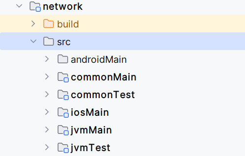

# Beschreibung des Inhalts des SDK-Repositorys

Dieses Dokument beschreibt die Inhalte des `zeta-sdk`-Repositorys (Stand
ZETA-SDK 2.0.0). Es ist als Monorepo aufgebaut und enthält neben dem
eigentlichen SDK — der Kernfunktionalität des ZETA-Clients — auch mehrere
Test-Clients.

## Inhaltsverzeichnis

- [Verzeichnisse](#verzeichnisse)
  - [Fachliche Verzeichnisse](#fachliche-verzeichnisse)
  - [Technische Verzeichnisse](#technische-verzeichnisse)
  - [Struktur der Module](#struktur-der-module)
- [Plattform- und Feature-Matrix](#plattform--und-feature-matrix)

## Verzeichnisse

Die folgenden Verzeichnisse sind in dem Repository vorhanden:

### Fachliche Verzeichnisse

Kern-Verzeichnisse

| Verzeichnis             | Beschreibung                                                                                                         |
|-------------------------|----------------------------------------------------------------------------------------------------------------------|
| zeta-sdk                | Core-SDK-Modul (öffentliche API, inkl. der C-API für native Anbindungen)                                              |
| zeta-client             | Demo-Client (Kotlin Multiplatform: JVM, Android, iOS, macOS)                                                         |
| iosApp                  | Xcode-Projekt der iOS-Demo-App                                                                                       |
| zeta-client-java        | Beispiel-Client in Java                                                                                              |
| zeta-client-cpp         | Beispiel-Client in C++ (Gradle-Build; HTTP und WebSocket)                                                            |
| zeta-nativeclient-cpp   | Eigenständiger C++-Client, der die Shared Library des SDK direkt nutzt (Makefile-Build für macOS, Linux und Windows) |
| zeta-csharp-nuget       | C#-SDK und die NuGet-Pakete je Plattform (`Zeta.Sdk.Linux`, `Zeta.Sdk.Windows`, `Zeta.Sdk.MacOS`) samt Beispiel     |
| zeta-testdriver         | Testdriver (Proxy-Client) und Load-Driver für Lasttests                                                              |
| zeta-testdriver-core    | Gemeinsamer Code der Testdriver (z. B. OIDC-Launcher und OTP-Abruf aus dem MailCatcher)                              |
| zeta-android-testdriver | Android-Testdriver: SDK in einer Android-App mit eingebettetem HTTP-Server und eigener, kleinerer Test-API (u. a. für Push-Benachrichtigungen) |
| zeta-nativetestdriver   | Testdriver auf Basis der nativen Laufzeit (Kotlin/Native)                                                            |
| attestation-service     | Attestierungsdienst für TPM-basierte Attestierung unter Windows und Linux (für eine spätere Spezifikationsversion)    |
| docs                    | weitere Code-nahe Dokumentation                                                                                      |

Hier sind die verschiedenen Module abgelegt.

| Verzeichnis         | Beschreibung                                                                                                              |
|---------------------|---------------------------------------------------------------------------------------------------------------------------|
| common              | gemeinsam genutzter Code wie Logging, Uhr (`ZetaClock`) und Plattformkonfiguration                                        |
| asl                 | ASL-Implementierung                                                                                                       |
| attestation         | Attestierungs-Modul, inkl. hardwarebasierter Attestierung auf Android (Key Attestation, Play Integrity) und Apple (App Attest) |
| authentication      | Authentifizierungs-Modul, inkl. OIDC-Flow und E-Mail-Bindung                                                              |
| client-registration | Modul für die Client-Registrierung                                                                                        |
| configuration       | Service-Discovery: Lesen der `.well-known`-Dateien                                                                        |
| crypto              | Kryptografie-Funktionalität                                                                                               |
| flow-controller     | Kern-Steuerungslogik des SDK                                                                                              |
| network             | Netzwerk-Modul (z. B. HttpClient, TLS-Validierung, Sperrprüfung)                                                         |
| notifications       | Client für den Notification Service (Verwaltung von Pushern und Kanälen, Entschlüsselung, Historie; Vorschau)             |
| storage             | Storage-Modul                                                                                                             |
| tpm                 | Zugriff auf das TPM bzw. den Hardware-Schlüsselspeicher der Plattform oder alternative Implementierungen                  |
| ktor-client-curl    | Angepasster curl-basierter HTTP-Client für die nativen Desktop-Plattformen                                                |

### Technische Verzeichnisse

| Verzeichnis | Beschreibung                                     |
|-------------|--------------------------------------------------|
| build-logic | Gradle-/Kotlin-Code, um die Komponenten zu bauen |
| gradle      | Gradle Installation                              |
| build       | Build-Ergebnisse                                 |

### Struktur der Module

Je nach Bedarf enthalten die Module plattformspezifische Unterverzeichnisse.

Hier ein Beispiel für das Netzwerk-Modul:

Die Verzeichnisse enthalten den gemeinsamen Code — mindestens die API des Moduls
— sowie die plattformspezifischen Implementierungen, sofern es sie gibt.

| Verzeichnis | Beschreibung                                                              |
|-------------|---------------------------------------------------------------------------|
| common      | gemeinsame API                                                            |
| jvm         | Code spezifisch für JVM-Implementierung                                   |
| android     | Code spezifisch für die Android-Implementierung                           |
| ios         | Code spezifisch für die iOS-Implementierung                               |
| desktop     | Code spezifisch für die Desktop-Implementierungen (Windows, Linux, macOS) |

Hinweis: Nicht alle Plattformen werden aktuell unterstützt.

Weitere Details sind dem Umsetzungskonzept zu entnehmen.

## Plattform- und Feature-Matrix

Die folgende Tabelle zeigt, welche SDK-Funktionen auf welchen Plattformen bzw.
in welchen Sprach-Anbindungen derzeit verfügbar sind. Mit „Vorschau“
gekennzeichnete Funktionen sind Teil der ZETA-Stufe 2 und können sich noch
ändern. „derzeit nicht verfügbar“ trifft keine Aussage über eine spätere
Verfügbarkeit.

| Feature                                   | Kotlin/Android | iOS       | JVM                         | C#                      | C++                     | Java                    |
|-------------------------------------------|----------------|-----------|-----------------------------|-------------------------|-------------------------|-------------------------|
| Kern-Auth-Flow (SM-B/SMC-B)               | verfügbar      | verfügbar | verfügbar                   | verfügbar               | verfügbar               | verfügbar               |
| HTTP- und WebSocket-Aufrufe über den PEP  | verfügbar      | verfügbar | verfügbar                   | verfügbar               | verfügbar               | verfügbar               |
| Hardwarebasierte Attestierung             | verfügbar      | verfügbar | derzeit nicht verfügbar     | nur macOS (App Attest, sofern verfügbar) | nur macOS (App Attest, sofern verfügbar) | derzeit nicht verfügbar |
| OIDC-Flow mobil (Vorschau)                | verfügbar      | verfügbar | verfügbar                   | derzeit nicht verfügbar | derzeit nicht verfügbar | derzeit nicht verfügbar |
| Notifications: Pusher und Kanäle (Vorschau) | verfügbar    | verfügbar | nur für Tests (interne API) | derzeit nicht verfügbar | derzeit nicht verfügbar | derzeit nicht verfügbar |
| Notifications: Entschlüsselung und Historie (Vorschau) | verfügbar | verfügbar | nur für Tests (interne API) | derzeit nicht verfügbar | derzeit nicht verfügbar | derzeit nicht verfügbar |
| `changeEmail` (Vorschau)                  | verfügbar      | verfügbar | verfügbar                   | derzeit nicht verfügbar | derzeit nicht verfügbar | derzeit nicht verfügbar |

Anmerkungen:

- **Hardwarebasierte Attestierung:** Auf Android nutzt das SDK Android Key
  Attestation (optional ergänzt um Google Play Integrity), auf iOS Apple App
  Attest; die native Bibliothek für macOS (C-API, C#) nutzt ebenfalls App
  Attest, sofern verfügbar. Auf allen anderen Plattformen und auf Geräten ohne
  Unterstützung gilt die über `AttestationConfig` gewählte, standardmäßig
  softwarebasierte Attestierung. Siehe
  [Wie Sie das ZETA-SDK integrieren](../Anleitungen/Wie_Sie_das_ZETA_SDK_integrieren.md#attestierung).
- **Notifications auf der JVM:** Es existiert nur die interne Test-Variante
  `notificationsForTesting()` (annotiert mit `@InternalZetaApi`) für den
  Testdriver; die unterstützte `notifications()`-API gibt es nur auf Android
  und iOS. Siehe
  [Wie Sie das SDK-Notifications-Modul verwenden](../Anleitungen/Wie_Sie_das_SDK_Notifications-Modul_verwenden.md).
- **OIDC-Flow mobil:** Siehe
  [Wie Sie den mobilen Client-Flow mit dem ZETA-SDK umsetzen](../Anleitungen/Wie_Sie_den_mobilen_Client-Flow_mit_dem_ZETA_SDK_umsetzen.md).
- **Java** nutzt das JVM-Artefakt (`zeta-sdk-jvm`); die Kotlin-Klassen der
  Vorschau-Features sind dort zwar enthalten, ihre suspend-basierten
  Callback-Schnittstellen (`AuthorizationLauncher`, `OtpCallback`) haben aber
  keine Java-Helfer und sind daher als derzeit nicht verfügbar eingestuft. Der
  blockierende Helfer `ZetaSdkClientExtension.changeEmail` existiert, setzt aber
  einen über den OIDC-Flow registrierten Client voraus.
- **C# und C++** binden das SDK über die native C-API an; diese exportiert
  derzeit nur Build/Lifecycle-, Registrierungs-/Authentifizierungs-, HTTP- und
  WebSocket-Funktionen. Die `platformProductId` ist dort fest je
  Betriebssystem vorgegeben. Das C#-SDK wird als NuGet-Paket je Plattform
  (Linux x64, Windows x64, macOS ARM64) bereitgestellt.
